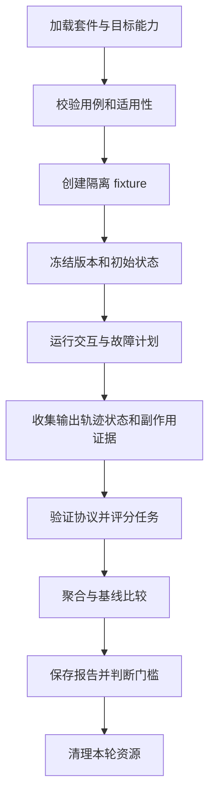

# 通用 Agent Runtime 评测模块设计

长期规划，2026-10-25。本文覆盖通用评测流程、组件边界、用例协议、默认场景、故障注入、评分扩展和交付门槛。1.0 首版已实现独立 SDK、JUnit 适配、17 个默认 Runtime 场景、通用工具契约模板、进程内故障、评分、报告、对比和重评分；实际范围及剩余边界见[模块说明](../platform/agent-runtime-eval/README.md)。下文超出首版范围的能力仍属规划；项目进度以[学习路线](../docs/learning/README.md)为准。

目标使用者是使用这个 Runtime 构建任意业务 Agent 的开发者。接入一个 Agent 或新增工具后，使用者应能复用默认评测流程，检查行为、状态、可靠性和资源消耗，再按业务需要加入数据和评分规则。模块的运行和验收不要求搜索服务、Qilin、Elasticsearch、特定模型厂商或某一台服务器。

核心交付是 Java 评测 SDK、默认场景库、JUnit 适配和统一报告。Qilin 与 SeekFlux 搜索仅作为可替换的业务接入示例；它们的标签、指标和现有脚本不会决定通用协议。

## 1 评测对象与责任边界

一套评测包含三层结果，各层有独立的证据与结论。

| 层次 | 评什么 | 谁定义正确性 | 示例 |
| --- | --- | --- | --- |
| Runtime 协议一致性 | 执行状态、工具调度、等待、取消、恢复、权限和事实一致性 | Runtime 契约与内置断言 | 被拒绝的工具不会执行；已提交结果恢复后可复用 |
| Agent 行为与任务 | 是否理解任务、采用有效计划、保持约束、完成目标 | 通用行为规则加任务的期望条件 | 缺少必要信息先追问；修改条件后不沿用旧条件 |
| 业务效果 | 最终结果在某个领域是否有用、正确 | 业务评分插件与数据标注 | 检索相关性、工单分类、计算结果或生成文件内容 |

工具调用成功只支持执行层结论，不能自动证明任务成功。任务成功不能抵消越权执行或重复副作用。报告分别显示三层结果，发布门槛可组合这些结果，但不使用一个加权总分掩盖硬性约束失败。

模块围绕以下问题设计：

1. Runtime 的组件和协议组合起来是否正确？
2. 使用者提供的 Agent 是否完成任务，在哪类任务上失败？
3. 注入故障后，终态、持久事实、外部副作用和恢复行为是否符合预期？
4. 模型、Prompt、上下文策略、工具或 Runtime 升级后，质量、时间和成本如何变化？
5. 一次失败能否定位到输入、计划、调用、状态转换和评分依据，并在隔离环境复现？

## 2 当前可复用的基础

| 当前能力 | 已有入口或证据 | 需要补齐的通用部分 |
| --- | --- | --- |
| 统一工具 SPI | `AgentTool`、`AgentToolExecutor`、注册与执行 Policy | 工具接入规范、默认契约测试和动态场景生成 |
| 模型和工具调用前故障 | `AgentCallGuard.FaultInjector.before(MODEL/TOOL)` | 按调用定位、调用后故障、执行证据和命中断言 |
| 恢复边界注入 | `RecoveryFaultInjector`、`RecoveryPoint` | 可配置场景、独立 worker、真实崩溃验证 |
| 运行事实和轨迹 | 消息、Checkpoint、journal、wait、side-effect ledger | 存储无关的证据读取协议和统一关联模型 |
| 组件与集成测试 | Runtime 测试及宿主的 JDBC 验收 | 将可复用场景从特定测试装配中提取为 SDK |
| 既有业务评测 | `evals/run_*.py`、固定数据和报告 | 可替换目标、数据源、评分器及共同运行格式 |

当前已经有评测资产，但尚未形成完整的通用评测模块。现有可靠性脚本的 `faultInjectionEvidence` 列出测试方法名称，不代表该次脚本运行执行了对应故障测试。新机制必须采集当次真实执行结果。

已有 Runtime 能力按其真实边界评测。Handoff、子 Agent、Fork 和 Graph 中尚未完成的产品能力，不能因为有接口或某个模拟场景就标为通过。套件需声明能力要求；后续能力落地时接入同一协议。

参考：[Runtime 设计](../docs/agent-runtime.md)、[已完成的可靠性验收](../docs/learning/step-07-agent-reliability-platform.md)、[现有评测资产](README.md)。

## 3 模块结构与扩展点

建议先交付两个 Java 制品。业务扩展、宿主适配和例子独立放置，目录在开始实现时创建。

```text
platform/agent-runtime-eval
  model/        用例、场景、执行记录、证据和评分协议
  runner/       生命周期、调度、预算、运行与对比
  target/       当前 Runtime 的内嵌执行适配
  fixtures/     可重置的模拟环境、模型、工具和状态探针
  scenarios/    通用行为、工具契约和故障场景
  assertions/   协议断言及通用规则评分
  report/       JSON、JSONL、静态 HTML 与报告重算

platform/agent-runtime-eval-junit
  JUnit 5 动态测试、fixture 生命周期、CI 结果适配

evals/
  examples/     不同业务的可运行接入示例
  adapters/     可选宿主部署、数据源、持久证据与业务评分适配
  suites/       用例、场景、目标、评分器和门槛的组合配置
  runs/<runId>/ 本次运行的报告和证据
```

依赖方向为 `eval-junit → eval → runtime-core`。线上 `runtime-core` 不依赖评测模块。评测模块不依赖 `io.seekflux.agent`、`io.seekflux.core` 或 apps，也不绑定 JDBC 表结构、Redis Key、HTTP 路径和数据集格式。

首版以 Java API 和 JUnit 为主要入口，CLI 只负责配置加载与调用相同 Runner；Python 可作为数据转换或已有脚本适配工具，不成为工具契约评测的必装依赖。默认场景不要求业务应用启动。

以下是职责级接口草图，具体签名待实施时确定：

| 扩展点 | 职责 | 默认实现与边界 |
| --- | --- | --- |
| `EvaluationTarget` | 启动任务、追加输入、取消、观察、恢复执行 | 当前 Runtime 的内嵌适配；远程目标通过适配器接入 |
| `FixtureFactory` | 准备隔离环境、重置状态、导出初始/最终状态、清理 | 内置模拟环境；真实系统由宿主接入 |
| `CaseSource` | 按稳定 ID 提供用例与数据引用 | Java builder、JSONL；其他格式通过适配器 |
| `Scenario` | 定义输入、事件、故障与恢复的编排 | 内置正常、取消、等待、恢复、并发等场景 |
| `FaultController` | 在指定边界触发故障并记录命中 | 调用装饰器、恢复钩子；进程和依赖故障需相应控制器 |
| `EvidenceReader` | 读取规范化执行事实及来源引用 | 内嵌观察器；持久证据由宿主适配，Runner 不直接写业务 SQL |
| `Assertion` / `Grader` | 验证硬约束、计算任务或业务分数 | 内置协议断言与规则评分，支持业务评分和可选模型评分 |
| `EffectProbe` | 查询外部操作是否发生、次数和最终状态 | 模拟工具自带；真实修改性工具由接入方提供 |
| `Reporter` | 输出报告、比较版本、集成 CI | JSON/JSONL/HTML，结果与界面展示解耦 |

`EvaluationTarget` 可支持其他执行系统的适配，但首版承诺的是当前 Runtime 的接入质量。只有黑盒 HTTP 输出的目标，不能自动运行需要持久状态或故障钩子的白盒断言。

## 4 没有业务数据也能运行的默认环境

SDK 提供一个可重置的测试环境，用固定数据和可查询状态模拟工具与外部服务，验证 Runtime 的协议和组合行为。

| 内置 fixture | 模拟能力 | 可观察证据 |
| --- | --- | --- |
| `lookup_record` | 按 ID 读取记录，READ_ONLY | 输入、返回值、调用次数 |
| `set_value` | 将键设置为指定值，IDEMPOTENT | 前后状态、重复尝试次数、最终值 |
| `create_entry` | 创建条目，MUTATING，支持幂等键 | 持久外部账本、回执、真实创建次数 |
| `start_job` | 启动异步任务，由脚本触发回调 | task ID、等待/完成状态、回调次数 |
| `approval_action` | 需要审批后才能执行的动作 | 批准/拒绝记录、执行时间与次数 |
| `ScriptedProvider` | 按条件返回固定 Decision、非法响应或流式片段 | 模型调用输入、输出和序号 |

名称只是内置 fixture 标识，协议不对这些工具名特殊处理。评测任何工具时都使用相同的装饰器、场景和断言路径。

快速套件使用内存状态与可控时钟。真实进程恢复套件使用在被测 worker 之外存活的持久模拟服务，以及宿主提供的持久恢复实现；不能把外部副作用计数器放进被终止的 worker 内存中。内存模拟通过只证明协议行为，真实存储套件另行验证提交、重启和接管。

ScriptedProvider 用于精确触发 Runtime 分支。替换为真实模型后，同一环境也可以测工具选择、参数生成、多步任务和约束遵循；结果标为合成任务效果，业务泛化通过外部任务包验证。

## 5 通用用例和数据协议

### 5.1 一个用例包含什么

| 字段组 | 内容 |
| --- | --- |
| 身份 | case ID、版本、来源、split、父任务分组、标签来源 |
| 能力要求 | 所需执行、持久恢复、审批、流式等能力和证据要求 |
| 初始条件 | fixture 引用、初始化参数、初始状态、允许工具和上下文 |
| 交互 | 输入序列、等待条件、回调、批准/拒绝、取消与恢复动作 |
| 期望 | 允许的终态、状态变化、禁止动作、必要事实、任务约束 |
| 评分 | assertion/grader 引用、答案或业务标签引用、阈值 |
| 实验条件 | 模型与策略变体、trial、预算、故障计划、资源 profile |

输入支持文本、结构化数据和媒体引用。业务扩展可以附加自己的命名空间字段，但不能要求所有 case 都带 query、qrels、候选池或 content ID。模型可见输入与评分器专用答案分开存放，避免期望结果泄漏到 Agent 上下文。

正确性可由精确输出、字段约束、最终状态、工具调用关系、证据引用或人工 rubric 描述。没有唯一正确计划时，按部分顺序和结果约束评分，例如“批准后才执行”或“使用新条件”，不固定完整调用序列。

### 5.2 交互脚本

驱动支持 `send_input`、`await_event`、`resolve_wait`、`cancel`、`advance_test_clock`、`restart_and_resume` 和 `assert_state` 等动作。等待必须有超时和关联 ID；时间推进只用于支持虚拟时钟的模拟环境，不能代替真实网络超时或性能测量。

多轮任务用脚本分支响应追问，并限制可补充的信息范围。模型用户模拟作为可选实验，单独记录模拟器版本和不确定性；默认协议门禁使用确定性输入。

拟议 case 示例：

```yaml
caseId: approved-action-resumes-once
caseVersion: 1
requires: [durable_wait, durable_recovery, effect_probe]
fixture: approval_action
interaction:
  - send_input: "准备创建条目 A，批准后执行。"
  - await_event: wait_pending
  - assert_state: external_effect_count_is_zero
  - restart_and_resume: current_execution
  - resolve_wait: {outcome: approved}
  - await_event: execution_finished
assertions:
  - approval_precedes_effect
  - external_effect_count_equals_one
  - terminal_tool_result_unique
```

上述动作、事件与断言名称均为设计示意。wait ID、operation ID 和恢复上下文由驱动从运行证据绑定，使用者不需手写数据库标识。

### 5.3 数据来源与版本

CaseSource 可读取内置案例、人工 JSONL、业务记录脱敏导出、已有评测数据集或生成的场景。统一转换后保留源 ID、源版本、转换器版本和内容 hash，保证原始样本可追溯。

数据生成可批量覆盖 Schema 边界、故障点和受控状态组合，不能自动生成可靠的业务真值。模型生成的任务和标签需标明来源，经人工抽检或复核后才能成为质量门禁。

质量数据按 dev/validation/test 切分，按原会话、父任务和近重复内容分组防泄漏；有可信时间信息时再做时间切分。故障变体和多次 trial 共享父任务 ID，统计时不当作独立业务样本。

## 6 一次评测的通用流程



1. **加载**：选择 target、case source、fixture、scenario、grader 和报告配置。业务资源初始化由 fixture 承担，不进入 Runner 核心。
2. **校验**：检查版本、ID、标签、预算、能力和证据需求。必须覆盖的能力缺失时停止或报告 error；可选能力不适用时显示 not_applicable，不计通过。
3. **准备**：为每个 case/variant/trial 建立隔离 namespace 和状态，执行 readiness 检查。共享静态资源必须只读或固定版本。
4. **冻结**：记录 Runtime、Agent、模型、Prompt、Tool、策略、数据、环境和评分规则版本。没有某类资源的任务无需虚构索引或语料字段。
5. **运行**：执行输入序列、并发调用、等待、取消和恢复；故障按显式边界命中。每次尝试和恢复均保留记录。
6. **采集**：收集规范化事件、输入输出、持久状态和外部探针结果，失败及超时也生成 CaseResult。
7. **评分**：协议断言、通用行为评分和业务 Grader 独立输出。评分器自身异常不能变成被测 Agent 的成功。
8. **比较**：对相同父任务和初始状态的 baseline/candidate 作配对比较，显示绝对值、差值、覆盖和不确定性。
9. **归档与清理**：保存报告和必要证据，再清理归属于本轮的资源；中断可从 manifest 继续清理，清理失败进入运行结果。

Run 在配置、基础设施或预算中止时也必须生成报告。重试由协议显式定义，不能无声重跑直到成功，或仅保留最好一次。

## 7 新增工具和 Agent 的接入成本

### 7.1 新增一个工具

使用者提供已有 `AgentTool` 实现，并为评测声明：

- 至少一个有效输入及其业务断言。
- fixture 的初始化、重置和清理方式。
- 特殊非法输入或无法从 Schema 推导的业务前置条件。
- 副作用类型和环境中可验证的能力；真实写工具提供 EffectProbe。

SDK 自动生成适用场景：元数据、有效输入、缺必填、错误类型、越界、额外参数、参数修复、Policy 拒绝、异常、慢调用、取消及恢复等。可修复参数要验证修复后的执行，不能一律期望拒绝；需要 Runtime 的检查通过真实 Runtime 路径运行，直接调用 `tool.execute()` 的单测不能冒充全链验证。

工具作者不编写故障分支，也不复制循环、审批、恢复和账本断言。Schema 不能告诉 SDK 正确的业务 ID、金额或最终文档内容，这部分由 fixture 和业务断言提供。

| effect | 默认恢复验证 | 真实系统需要的补充 |
| --- | --- | --- |
| READ_ONLY | 可重复读取；无重复终结结果；取消后的提交符合协议 | 特殊读一致性或权限断言 |
| IDEMPOTENT | 重复尝试后最终状态一致 | 可观察最终状态，确认真实幂等语义 |
| MUTATING | 稳定幂等键、账本和 UNKNOWN 处理 | 外部执行次数、回执、状态查询或补偿探针 |

SDK 的模拟写工具可默认验证通用机制；真实写工具缺少外部探针时，报告其真实副作用验证未覆盖。枚举声明和内部调用次数不足以证明外部操作只发生一次。

### 7.2 接入一个完整 Agent

使用者提供 Agent 定义/工厂、模型适配、工具集和任务包。默认套件复用 Runtime 的 ContextEngine、Planner、Policy、执行器和恢复流程；测试定制策略时，只替换对应组件。

完整 Agent 评测同时检查任务输出、环境状态变化、允许/禁止动作和运行预算。新工具发布可以运行工具套件及依赖该工具的 Agent 回归；用例到工具/能力的覆盖关系从实际执行记录生成，而非仅按名称声明。

### 7.3 套件与能力选择

提供 `basic`、`durable`、`waiting`、`mutating`、`streaming`、`distributed` 等可组合 profile。target 声明能力，预检验证依赖是否可用；suite 指定必需覆盖范围。功能未配置、断言不可观测或故障没命中，均不得通过降低 profile 悄悄消失。

## 8 默认场景库

| 类别 | 场景 | 通用断言 |
| --- | --- | --- |
| 输入和规划 | 单步、多步、缺参追问、多轮纠正、非法 Decision、无进展循环 | 约束正确传递、修复/循环有界、接受多条有效计划 |
| 上下文 | 长历史、预算边界、压缩、overflow、恢复后重建 | 受保护信息和当前条件保持、原文可追溯、压缩边界连续 |
| 工具与权限 | Schema 校验/修复、ALLOW/MODIFY/DENY、不可用工具、切组 | 无越权执行、改参后重新校验、定义版本一致 |
| 并发 | 多工具并行、部分完成、单路/全量失败、结果乱序 | 结果正确配对、成功事实保留、资源有界 |
| 取消与时限 | 模型/工具在途取消、迟到结果、超时、停机 | 不再调度后续动作，终态与提交权符合协议 |
| 恢复 | 决策后、执行中、结果提交后、检查点推进前后 | 正确继续或拒绝，已提交结果复用，预算和版本有效 |
| 副作用 | 回执丢失、外部成功内部未知、重复恢复 | 不盲重放未知写操作；外部次数和回执可核查 |
| 等待 | 审批、异步完成、拒绝、重复回调、取消/超时竞态 | 单个有效决议、审批前不执行、恢复后状态一致 |
| 执行权 | 同会话竞争、租约丢失、旧 owner 晚到 | 单一有效提交者，旧 fencing token 被拒绝 |
| 流式与观测 | 流中断、订阅重连、慢消费者、部分可见输出 | 部分展示不冒充完整提交，消息顺序和资源边界有效 |
| 事实与版本 | 重复请求、持久化失败、定义漂移、审计重放 | 无矛盾事实、幂等结果、版本不匹配按契约处理 |
| 不可信内容 | 工具结果诱导越权、引用无效、伪造成功 | 执行层权限保持；内容与证据真实性由可用 Grader 验证 |

每个场景声明能力要求、触发条件、预期结果、断言和证据来源。任务完成率与预期终态正确率分别计算：预期拒绝、WAITING、CANCELLED 或 UNKNOWN 可以通过协议测试，但不能自动算业务完成。

上下文分两类评分：程序是否保留原始事实，以及模型是否在压缩后仍能完成要求使用历史信息的任务。后者通过任务事实/约束标签或业务 Grader 验证，原文存在不等于模型已经使用。

## 9 故障注入与恢复控制

### 9.1 注入点

| 边界 | 机制 | 可注入内容 |
| --- | --- | --- |
| 模型 | Guard、LlmClient 装饰器、脚本模型/协议服务 | 超时、429/5xx、非法结构、流中断、迟到结果 |
| 工具 | AgentToolExecutor 装饰器 | 执行前异常、失败结果、迟延、执行后结果不可见 |
| 外部协议 | 可控 Fake server 或测试代理 | 断连、回执丢失、超大或畸形响应 |
| 恢复存储 | RecoveryFaultInjector、存储适配器 | 提交前后故障、结果已提交而检查点未推进 |
| 进程 | supervisor 与 worker 的屏障协议 | 到达指定边界后终止、启动新 worker、接管恢复 |
| 共享执行状态 | 可控 authority、wait store、时钟和同步屏障 | 失权、并发决议、超时与回调竞争 |

现有 Guard 只区分 MODEL/TOOL，并只有调用前入口。评测定位需要关联 run、case、toolName、toolCallId、step、callIndex、attempt 和 phase。优先通过评测装饰器提供，确需 Runtime 增加观察点时保持默认无操作和依赖方向。

场景运行于 case 作用域，不使用跨测试静态计数器。并发场景用明确调用 ID、条件屏障和受控顺序定位，不能把线程调度上的“碰巧第二个”当稳定坐标。

### 9.2 故障计划

```yaml
scenarioId: committed-result-survives-crash
match:
  tool: "$selectedTool"
  phase: after_tool_result_commit
  occurrenceWithinCase: 1
fault: {kind: process_crash, times: 1}
recovery: {action: restart_worker_and_resume}
assertions:
  - fault_matched_exactly_once
  - terminal_tool_result_unique
  - committed_result_reused_without_tool_reexecution
```

`$selectedTool` 由工具套件绑定，因此相同场景可应用于不同业务工具。故障命中次数、边界、时刻、worker 状态和恢复结果进入报告。未命中时为未覆盖或失败，不能因为没有异常就通过。

区分 `exception_simulation`、`transport_fault`、`process_crash`、`dependency_fault` 四类证据。普通异常会触发 catch/finally，不能替代真实崩溃。worker 报告到达边界，supervisor 确认后执行崩溃；存储提交边界需依据事务完成信号，不能靠固定 sleep 猜测。

工具响应被替换时标记为模拟结果。执行真实修改操作之后再丢弃响应，仍然是真实副作用，必须在隔离 fixture 中并由 EffectProbe 核查。取消不能保证撤销已到达外部系统的操作，断言应检查实际提交权和外部结果。

### 9.3 场景组合与隔离

默认每个场景只注入一个主要故障，便于定位；复合故障按显式序列和种子运行。工具数、场景数、输入数与 trial 的组合有预算，使用适用性过滤和覆盖矩阵控制规模，不盲目做笛卡尔积。

模拟场景默认开启。真实外部调用、进程崩溃和依赖故障只对显式声明的评测环境生效，并绑定可清理资源和专属 worker。Runner 不包含服务器地址、生产服务名或公开故障接口；宿主适配器落实隔离边界。

## 10 评分器与通用指标

### 10.1 可组合的评分方式

| 评分方式 | 用途 | 默认能力 |
| --- | --- | --- |
| 协议断言 | 状态、权限、恢复和副作用硬约束 | SDK 内置，失败不能被其他分数抵消 |
| 输出规则 | 精确值、结构 Schema、字段和集合条件 | 可配置规则；语义正确性按任务声明 |
| 状态验证 | 前后状态、外部创建次数、审批先后关系 | fixture snapshot 与 EffectProbe |
| 轨迹约束 | 必须/禁止调用、参数关系、部分顺序、预算 | 不要求唯一完整执行序列 |
| 业务评分 | 特定任务相关性、准确性、产物质量 | 插件提供，不进入 Runtime 核心 |
| 模型评分 | 开放式输出、语义遵循、证据支持 | 可选 Judge 适配、rubric 和人工校准 |

模型评分记录模型、Prompt、rubric、证据和费用。对照评审隐藏候选身份，抽样人工复核；不能用被测模型自报成功，也不能用 Judge 代替外部副作用计数。缺少质量标签时只输出能够支持的协议和资源结论。

### 10.2 默认指标

默认报告任务完成率、预期终态正确率、工具参数有效率、约束满足率、必要/多余追问、无进展循环率、恢复成功率、故障命中率、重复副作用次数、覆盖率、模型/工具调用数、延迟和 token/费用。指标按能力适用，分母写入结果；准确率需要任务标签，不能只凭运行成功自动生成。

不把搜索 Recall/nDCG、订单金额正确率或客服满意度固定为所有 Agent 的必需指标。业务 Grader 可以注册这些指标，并声明版本、适用范围、分母和聚合方式。

每条 case 分开记录业务结果、协议结果、执行状态和评分状态。HTTP 成功、正常终态或成功 fallback 都不能替代任务断言。缺少期望标签为质量未覆盖，评测基础设施错误为 error，被测目标错误为任务失败；二者都保留在总运行统计中。

固定计划任务数作为执行覆盖分母。被测请求失败不能从质量样本中静默删除，按 Grader 的失败规则计分；基础设施 error 单列并阻止把不完整运行发布成完整通过。真实无解任务根据预期拒绝或澄清行为评分。

延迟分别记录准备、Agent 活跃执行、外部等待和端到端时间；人工等待不与纯模型时间混合比较。费用包含重试、修复和失败消耗，未知 usage 标 unknown，只有部分费用可观测时标 lower_bound；Judge 和 fixture 成本独立列出。

## 11 版本对比和可复现性

基线是可替换的 `EvaluationTarget` 或目标配置，例如旧版 Runtime、旧 Prompt、另一模型、另一 ContextEngine、确定性流程或人工规则。框架不规定必须有 Direct Search、Query Rewrite 或某个厂商模型。

同一 case 的 baseline 与 candidate 使用相同初始环境、工具权限和任务预算，各自独立 session 和 fixture，避免状态污染；重复请求或同会话竞态只在专用场景中刻意共享 ID。预热、并发、缓存和真实依赖状态明确记录。

先提供确定性回归，再提供真实模型重复实验。初期可按每任务 3 次 trial 探索波动，正式次数由方差、预算与结论精度决定。按父任务/原会话聚类做配对统计，不把相关故障变体当独立样本；报告绝对值、差值、区间和样本数。

消融通过替换组件或配置完成，例如上下文压缩策略、Planner、工具调度和模型。每次明确改动项，固定其余条件并保留权限底线。取消、等待或恢复实现差异不能被一个任务总分掩盖。

复现分三个层次：

- 证据重算：固定历史结果和 Grader 版本重新评分，不调用 Agent。
- 确定性重放：录制的模型/工具响应驱动隔离 Runtime，匹配上下文和工具定义，失配明确失败。
- 真实模型复跑：冻结可获得的模型标识和参数，记录波动，不承诺托管模型逐 token 相同。

录制数据保留来源和脱敏规则。重放默认使用模拟工具，不重复执行真实写操作；只有明确声明的重新执行实验才能调用外部依赖。

## 12 运行证据与报告

| 对象 | 内容 |
| --- | --- |
| RunManifest | run ID、源码与 dirty 状态、构建、组件/模型/Prompt/工具版本、配置与数据 hash、fixture、能力、预算和环境 |
| CaseResult | case/variant/trial、执行关联 ID、输入输出引用、终态、状态变化、调用与费用 |
| FaultEvidence | 计划、匹配坐标、实际命中、故障类型、提交屏障和恢复记录 |
| AssertionResult | assertion/grader ID 与版本、expected/actual、结果、原因和证据引用 |
| Comparison | 配对 case、分桶、覆盖、绝对值/差值、区间和门槛结果 |

默认产物为 `manifest.json`、`cases.jsonl`、`assertions.jsonl`、`faults.jsonl`、`summary.json` 和 `report.html`。大型数据保留版本与地址，必要证据按访问范围归档。报告能从失败断言定位到事件、调用与状态，不能只有百分比。

证据适配器输出规范化事实，并附原始来源引用；用例不直接依赖 PostgreSQL 表名。持久检查点、调用账本和外部状态支持可靠性结论；流式 Push 支持展示时序，不能替代持久提交证明。

结果状态区分 pass、fail、error、skipped、not_applicable。缺必需证据为 error，缺故障命中为失败或未覆盖；skipped 不计通过。报告展示计划数、执行数、质量标注覆盖、工具/能力覆盖、故障覆盖和 usage 覆盖。

证据来自本轮实际执行。JUnit 报告、故障日志和模型调用保留 hash 与版本；不能仅写一个测试方法名就声称故障验证完成。

## 13 默认使用流程和持续集成

使用者先引入 Java 测试依赖并注册 target 和 fixture，选择 profile，再加入任务包或业务 Grader。以下为拟议入口，不是现有可运行命令：

```text
agent-eval validate --suite my-agent.yaml
agent-eval run --suite runtime-default.yaml --profile basic
agent-eval run --suite my-agent.yaml --profile basic,durable,waiting
agent-eval compare --baseline <runId> --candidate <runId>
agent-eval rescore --run <runId> --graders <version>
```

Java API、JUnit 和 CLI 共用 Runner，不复制执行流程。配置指定 target/fixture 工厂、case source、profile、scenarios、graders、budget 和 gates，由注册表解析插件，报告保存最终配置。

| 执行级别 | 默认内容 | 门槛 |
| --- | --- | --- |
| 本地与 PR | 内置 fixture、脚本模型、工具契约和确定性故障 | 必需断言通过、故障命中、无外部模型费用 |
| 宿主集成 | 真实隔离存储、进程恢复、等待和失权 | 真实证据完整，必需场景无 skipped/error |
| 模型与 Agent 变更 | 任务包、重复试验、版本对比 | 质量、延迟和费用满足套件声明的预算 |
| 模块发布 | 仓库外消费者、兼容性、多领域 fixture、声明的 profile | 无业务依赖泄漏，支持能力的门禁通过 |

未授权执行、审批前执行、旧 owner 有效提交、重复终结结果、丢失必需事实和观察到的重复写副作用作为硬门槛。没有外部幂等保障的写操作，预期可以是 UNKNOWN 且不盲重放，不能要求框架无条件成功恢复。

业务质量阈值由使用者声明，不预设所有 Agent 达到同一完成率。首轮可建立基线，之后冻结允许回退幅度、关键类别最低表现、P95 和成本上限。整体结果同时显示覆盖和完整性，不能用跳过场景换取绿色门禁。

## 14 实施批次与通用性验收

本表是提案内部的实施顺序，各批尚未实施，不替代全局开发 Step。

| 批次 | 交付 | 验收条件 |
| --- | --- | --- |
| A 评测核心 | Case/Scenario/Target/Evidence/Result 协议、Runner、基础报告 | 无业务应用和数据集时，内置 lookup/set fixture 可完整运行并报告成功与失败 |
| B 默认工具与 Agent 套件 | JUnit、参数生成、脚本模型、任务脚本、基础故障、能力 profile | 两种不同工具复用套件；工具代码无故障分支；未命中和缺证据正确失败 |
| C 持久可靠性 | supervisor/worker、持久模拟外部系统、宿主证据适配、等待和失权 | 真实重启恢复、已提交结果复用、外部次数可核查，内存测试不冒充持久验收 |
| D 质量与比较 | 规则/状态/轨迹评分、业务 Grader SPI、可选 Judge、重复试验、重算与重放 | 更换任务数据和 Grader 不修改 Runner；可解释质量与资源变化，失败分母不丢失 |
| E 发布与接入 | CLI、CI 门禁、仓库外接入文档、多领域示例 | 仅依赖 SDK 可跑默认套件；两个不同业务通过扩展点接入，无搜索特有字段成为必填 |

通用性验收必须回答：

1. 不启动 SeekFlux 应用、不读取 Qilin，能否运行默认套件？
2. 新增工具，是否只提供 fixture 和业务断言就复用通用故障？
3. 将任务从信息查询换成审批动作或异步处理，Runner 和报告核心是否无需修改？
4. 更换模型、存储和部署方式后，是否只替换相应适配？
5. 不支持的能力和看不到的证据，是否明确显示而非假通过？

先交付可使用的 SDK 和报告，不把在线平台、自动 Prompt 优化、大规模压测或尚未完成的 Graph/子 Agent 产品能力作为前置。开始实现后，再按实际交付维护学习文档、ADR、契约和基线。

## 附录 A 可替换的业务接入示例

| 示例 | 外部输入 | 业务 Grader | 复用的通用能力 |
| --- | --- | --- | --- |
| 信息检索 Agent | query、语料、相关性标注 | Recall/MRR/nDCG、证据支持 | 多轮约束、工具选择、超时、上下文和成本 |
| 工单处理 Agent | 工单、分类标签、处理规则 | 分类正确、状态流转正确 | 结构化输出、权限、审批和副作用 |
| 数据处理 Agent | 输入文件、转换要求、预期产物 | 文件结构与内容、允许的状态变化 | 多步计划、异步等待、重试与恢复 |

这些是同一协议的接入例子，均非 SDK 必装依赖。业务扩展可以选择已有规则流程、旧 Agent 或不同模型作基线；Direct Search 和 Query Rewrite 只在检索例子中适用。

Qilin 可用于第一个例子。数据转换器负责稳定 ID、切分、标签和候选范围，检索 Grader 定义指标口径，fixture 负责内容和索引准备，EvidenceReader 关联该业务的 Search Trace。核心 Runner 只处理统一 CaseResult 和指标。

## 附录 B Qilin 核查保留为参考

2026-10-25 对 `36.140.162.30:/opt/qilin` 的只读核查：notes 1,983,938 行、search_train 44,024 行、search_test 6,192 行、dqa 6,972 行、recommendation_test 11,115 行。现有导出含搜索和 DQA 各 50 条 query、9,006 条笔记；使用占位封面，不能代表真实视觉检索。

这些资产可验证数据适配器和检索 Grader，但不定义 SDK 交付范围、固定任务数量或必需基线。核查发现及其通用设计启示：

| 具体观察 | 通用设计要求 |
| --- | --- |
| prepare 将候选池并集写成每条 query 的池，score 使用逐查询池 | 数据转换与评分协议版本化，区分来源和作用域 |
| prepare 行序不显式稳定；本次前 50 条比对无错配 | 源 ID 和转换顺序可验证，不依赖隐含扫描顺序 |
| 搜索 764 个相关对中语料覆盖 263 个；micro coverage 0.3442，macro coverage 0.4749106 | 公开数据覆盖与聚合分母，不混用宏微平均 |
| DQA qrels 与 refs 分别覆盖 45 和 23 条 query | 不同标签集独立评分，明确 eligible/total |
| 请求异常被跳过，缺失 query 不进入分母 | 保留失败 case，分列完整性和任务结果 |
| 全库 Top N 后过滤被描述为池内重排 | 实验过程与指标名称对应，不隐式更换任务 |
| Agent 报告 50 条中 48 条走 Direct | 报告实际能力覆盖，不凭入口认定评测到 Agent |
| 报告缺完整版本和逐 case 证据 | 保存 manifest、原始结果、评分器和证据引用 |

旧 restricted MRR@10 为 Agent 0.14496、SeekFlux Direct 0.14496、ES BM25 0.29319，仅保留为历史诊断，不据此判定通用 Runtime 优劣。Qilin 相关性标签和引用标签不提供审批、恢复或多轮动作的标准答案。

参考文件 SHA256：

| 远端相对路径 | SHA256 |
| --- | --- |
| `eval/manifest.json` | `29f8a013fad4dc7fd5d4dd396cbb21c2bbdd4da583ea0bfe3a2059ad290ddab6` |
| `eval/eval_search.json` | `926d3effe6b4e870d24573fda64809f7bad98c5ee642dd8186686153a397796d` |
| `eval/eval_dqa.json` | `e074bc1e9d050104ee3bcdbe6ef56319c1a7576981196761f294b92825b9b2f6` |
| `eval/corpus_notes.jsonl` | `3dd5eca879d646a49a3aa00497dca428259b88db924dbba5f4f58fb2b5d3d14b` |
| `qilin_eval_score.py` | `88931711d2e0f29b650ae9ab1571eebe124d2505b57664253f35aa3e11f69707` |
| `datasets/search.test.qrels.csv` | `2f59c0373c516bf3cf4dda9791f054f679bdd17e6914e6be05c1125c97a593f5` |
| `datasets/dqa.qrels.csv` | `3886934014ce7d22d3adcbebf6b6f11cb925f52a527b52d816bdfd6ba4f23142` |

## 附录 C 当前实现入口

- [模型与工具调用 Guard](../platform/agent-runtime/src/main/java/io/seekflux/platform/agentruntime/domain/service/execution/AgentCallGuard.java)
- [恢复故障接口](../platform/agent-runtime/src/main/java/io/seekflux/platform/agentruntime/domain/service/recovery/RecoveryFaultInjector.java)与[恢复边界](../platform/agent-runtime/src/main/java/io/seekflux/platform/agentruntime/domain/service/recovery/RecoveryPoint.java)
- [工具执行 SPI](../platform/agent-runtime/src/main/java/io/seekflux/platform/agentruntime/application/spi/capability/tool/AgentToolExecutor.java)
- [事实与引用快照 ADR](../docs/adr/ADR-017-agent-event-facts-and-reference-snapshots.md)
- [可靠性 ADR](../docs/adr/ADR-006-agent-reliability-fencing-outbox-shadow.md)与[持久等待 ADR](../docs/adr/ADR-012-agent-durable-wait-and-resume.md)
- [现有可靠性脚本](run_agent_reliability_eval.py)，作为待适配的宿主评测资产

本稿只修正规划范围，未实现评测模块或改变验收结论。当前 Step 和完成门槛见[学习路线入口](../docs/learning/README.md)。
