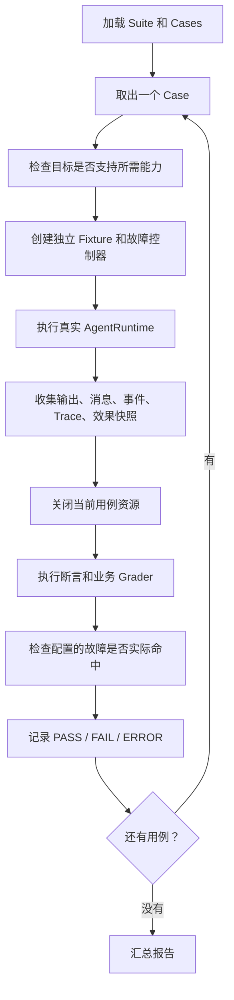

# Agent 评测模块设计、执行流程与使用指南

本模块把评测执行、故障注入、证据收集和报告做成通用流程，将被测 Agent、业务数据和正确性判断作为扩展点。新增 Agent 或工具时，可以复用这套流程，只提供与业务有关的实现和预期。

本文对应当前 `1.0.0-SNAPSHOT` 实现。默认 17 个场景使用脚本 Planner，驱动真实 `AgentRuntime`，主要验证执行行为。接入真实 Planner、工具和业务判断后，才能评测具体 Agent 的任务效果。

## 1 评测由哪些对象组成

| 对象 | 职责 | 示例 |
| --- | --- | --- |
| `Suite / Case` | 定义评哪些场景、输入、故障和预期 | 工具超时后应降级 |
| `EvaluationTarget` | 定义被测对象如何创建、执行和关闭 | 本地 Runtime、远程 Agent 服务 |
| `RuntimeFixture` | 为一个用例准备工具、Planner、配置和初始状态 | 创建独立的内存工具 |
| `FaultController` | 按规则统一注入故障 | 第一次调用某工具前抛异常 |
| `Evidence` | 保存实际发生的事情 | 输出、消息、事件、Trace、写入次数 |
| `Grader` | 根据证据判断是否符合要求 | 最终答案正确、没有重复写入 |
| `EvaluationRunner` | 管理整个流程、超时和结果汇总 | 依次执行所有用例 |
| `ReportWriter` | 输出结果文件 | HTML、JSON、JSONL |

`Fixture` 可以理解为“一条评测用例的实验环境”。例如要测一个修改记录的 Agent，就为这个用例准备初始记录、工具和状态读取方法。下一个用例重新创建环境，避免前一个用例留下的数据影响它。默认夹具使用内存状态；业务接入时，隔离测试账户、记录和清理资源由业务夹具负责。

模块依赖方向为 `agent-runtime-eval-junit → agent-runtime-eval → agent-runtime-core`。SDK 的生产依赖不包含 Spring、JUnit 或 SeekFlux 业务模块，Python 仅作为仓库内命令入口。

关键实现：

- [评测数据结构](src/main/java/io/seekflux/platform/agenteval/Evaluation.java)
- [统一执行器](src/main/java/io/seekflux/platform/agenteval/EvaluationRunner.java)
- [Runtime 目标适配器](src/main/java/io/seekflux/platform/agenteval/runtime/RuntimeEvaluationTarget.java)
- [夹具接口](src/main/java/io/seekflux/platform/agenteval/runtime/RuntimeFixture.java)

## 2 一次评测的完整流程

执行有两层循环：外层 Runner 遍历评测用例；内层 Runtime 执行该用例中的 Agent 决策和工具调用。



能力检查失败时不会启动目标，直接记录 ERROR。执行、资源清理或评分发生异常时，也会保留该用例的错误结果，而不会把它从报告分母中删除。

例如“工具执行前发生异常”的用例按以下步骤执行：

1. 创建工具和初始数据。
2. 给工具加上统一故障装饰器。
3. Runtime 调用 Planner，Planner 决定调用工具。
4. Runtime 检查允许范围、参数 Schema 和执行策略。
5. 准备进入工具体时，装饰器触发配置的异常。
6. Runtime 处理失败并产生结果。
7. 评测器检查是否按预期降级、工具体是否没有执行、故障是否确实命中。

评测统计的基本单位是 Case。一个 Case 可以包含多步决策和多次工具调用；故障规则则可以定位到这个 Case 内某个工具的第 N 次匹配。

## 3 故障注入如何复用

业务工具只保留正常执行逻辑，不需要加入评测故障分支：

```java
@Override
public AgentToolResult execute(AgentToolContext context) {
    // 正常业务处理
}
```

`RuntimeEvaluationTarget` 为工具统一添加 [FaultInjectingTool](src/main/java/io/seekflux/platform/agenteval/runtime/FaultInjectingTool.java)。装饰器保留工具的名称、Schema、Effect、来源及审批信息，故障位置在 Runtime 的 Schema 和策略检查之后。

例如以下规则表示：在当前用例中，第一次准备执行 `lookup_record` 的工具体时抛异常。

```json
{
  "id": "lookup-failure",
  "phase": "BEFORE_TOOL",
  "tool": "lookup_record",
  "occurrence": 1,
  "action": "THROW",
  "delayMillis": 0
}
```

| 注入位置 | 阶段名称 | 可用动作 |
| --- | --- | --- |
| Planner 执行前、执行后 | `BEFORE_MODEL`、`AFTER_MODEL` | 抛异常、延迟、取消 |
| 工具体执行前、执行后 | `BEFORE_TOOL`、`AFTER_TOOL` | 抛异常、延迟、取消 |

代码中的 MODEL 阶段当前实际包裹 `planner.decide()` 边界。使用脚本 Planner 时也会经过这些位置；它不代表一定调用了外部模型。

每条配置的故障必须恰好命中一次。如果工具名写错，导致异常没有注入，即使 Agent 最终返回正确答案，这条故障用例也不能通过。策略拒绝工具时不会进入工具体，也不会命中工具体故障；此类场景应检查“工具没有执行”。并发同名工具的第 N 次匹配按到达顺序计数，需要固定调用位置时应使用串行场景。

评测同时区分返回结果与实际效果。例如“写入后响应丢失”：

- 工具体已经修改数据。
- `AFTER_TOOL` 注入异常。
- Runtime 收到失败结果。
- 评测检查降级状态、最终存储值和实际写入次数。

这样能够发现“调用返回失败，但业务动作已经发生”的情况。当前默认场景使用内存状态验证这一语义，持久数据库事务和进程崩溃恢复仍需后续适配。

## 4 如何判断通过或失败

| 状态 | 含义 |
| --- | --- |
| `PASS` | 实际行为符合这个用例的预期 |
| `FAIL` | 行为不符合预期，或配置的故障没有命中 |
| `ERROR` | 无法正常完成评测，例如缺能力、缺证据、评分异常或评测超时 |

例如，“应该拒绝某工具”的用例，如果确实拒绝且没有执行工具体，就是 PASS。通过率表示符合固定场景预期，不能直接当作模型回答正确率。

默认评分由两部分组成：

- `ChecksGrader` 按用例中的 Check 检查输出、终态、效果快照等字段，支持相等、存在、集合大小、包含和数值上下界。
- `RuntimeInvariantsGrader` 交叉检查事件、完整消息和 Trace，包括终态一致、事件唯一且递增、运行身份一致、工具调用与结果配对、工具名称与冻结 Schema 一致。

业务 Grader 可以增加自己的判断。所有 findings 共同决定用例状态，ERROR 优先于 FAIL，FAIL 优先于 PASS，不使用一个综合分抵消硬约束错误。

外层用例超时覆盖创建、执行、清理和评分，与 Runtime 自己的 Deadline 独立。预期 Runtime 超时降级可以通过，外层 `CASE_TIMEOUT` 则记 ERROR。取消后会检查实际执行线程退出；若仍未退出，停止启动后续用例，并将其保留为 ERROR。

## 5 直接查看和运行默认评测

已有报告位于仓库 `.local/evals/agent-v1/`，打开 `baseline/index.html` 即可查看，每个用例可以展开断言和原始证据，无需重新执行。

后续需要运行演示时，在仓库根目录执行：

```powershell
python -X utf8 evals/run_runtime_eval.py --no-build demo
```

`--no-build` 使用当前已有构建和依赖路径。首次使用或修改源码后，去掉该参数重新构建：

```powershell
python -X utf8 evals/run_runtime_eval.py demo
```

需要 JDK 21、Maven 3.9+、Python 3。演示输出包括：

| 路径 | 内容 |
| --- | --- |
| `baseline/index.html` | 默认套件的 HTML 报告 |
| `candidate/index.html` | 故意返回错误答案的候选报告 |
| `comparison.json` | 基线与候选之间的回归用例 |
| `baseline/report.json`、`candidate/report.json` | 完整机器可读报告 |
| 两个报告目录内的 `cases.jsonl` | 逐用例结果 |
| `suite.json` | 实际使用的完整套件 |

负向对照使用同一套件和期望值，只在演示夹具中修改答案，不修改生产 Runtime。默认套件定义见 [default-suite.json](src/main/resources/agent-eval/default-suite.json)。

CLI 的 `run suite.json` 当前固定使用内置 `ScriptedFixture`，适合调整默认场景。仅替换 JSON 不会自动接入业务 Agent；自定义 Agent、工具和 Grader 目前通过 Java SDK 接入。

## 6 给新工具接入默认评测

提供工具工厂、一组合法参数和预期输出即可：

```java
var suite = ToolContractSuite.create(
        "convert",
        Map.of("text", "hello"),
        Map.of("result", "HELLO")
);

var target = ToolContractSuite.target(
        "my-agent",
        "build-123",
        MyIsolatedTool::new
);

var report = EvalCli.runner().run(suite, target);
ReportWriter.write(Path.of("target/evaluation"), report);
```

其中 `MyIsolatedTool` 是业务自己提供的工具实现，工具名应为 `convert`，工厂每次创建独立实例。示例省略 Java imports。

这段代码自动生成四类工具契约用例：正常调用、工具体执行前故障、工具体执行后故障、工具体执行前取消。故障注入、执行器、证据收集和报告不需要重新编写。

四类工具快捷用例与默认 17 个 Runtime 综合场景是两套不同模板。快捷模板目前接受 READ_ONLY 和 IDEMPOTENT 工具；MUTATING 工具需要配套的持久执行目标和副作用检查，快捷模板会明确拒绝。

模板能复用执行契约，但不能从 Schema 推断业务正确答案。业务副作用、测试数据和资源清理仍需业务夹具提供。完整代码示例见 [CustomToolContractTest.java](src/test/java/io/seekflux/platform/agenteval/CustomToolContractTest.java)。

## 7 接入完整业务 Agent

完整 Agent 通过自己的 Fixture 和业务 Grader 接入：

```java
var suite = EvalJson.read(
        Path.of("my-agent-suite.json"),
        Evaluation.Suite.class
);

var target = new RuntimeEvaluationTarget(
        "my-agent",
        "build-123",
        testCase -> new MyAgentFixture(testCase)
);

var runner = new EvaluationRunner(List.of(
        new ChecksGrader(),
        new RuntimeInvariantsGrader(),
        new MyBusinessGrader()
));

var report = runner.run(suite, target);
ReportWriter.write(Path.of("target/agent-evaluation"), report);
```

`MyAgentFixture` 和 `MyBusinessGrader` 是业务需要提供的实现，不是模块内置类。

| 提供的内容 | 需要解决的问题 |
| --- | --- |
| `tools()` | 这个 Agent 使用哪些工具？ |
| `planner()` | 使用哪一个真实决策实现？ |
| `definition()` | 允许哪些工具、最多多少步、运行多久？ |
| `policy()` | 是否使用自定义工具执行策略？ |
| `effects()` | 执行后，业务状态实际发生了什么变化？ |
| `close()` | 如何清理用例数据和连接？ |
| `MyBusinessGrader` | 什么结果才算完成业务任务？ |

Grader 接收 Case 和 Evidence，可检查分类标签、生成文件内容、最终记录状态等。框架提供通用检查，业务正确性由样例标签或业务判断规则定义。

远程服务或其他执行入口可以直接实现 `EvaluationTarget`，负责 `open → execute → close`，并声明实际支持的 capabilities。此时可复用 Runner、通用 Check 和业务 Grader；只有提供 Runtime 所需完整消息与事件的目标，才应使用 `RuntimeInvariantsGrader`。

## 8 接入 JUnit、版本比较与重评分

JUnit 适配器可以把一份报告转换为独立的动态测试：

```java
@TestFactory
Stream<DynamicTest> agentEvaluation() throws Exception {
    var report = EvalCli.runner().run(DefaultSuite.load(), EvalCli.target());
    ReportWriter.write(Path.of("target/evaluation"), report);
    return AgentEvaluations.tests(report);
}
```

这使每个 Case 都有独立测试结果，可以接入项目已有的 CI 门禁。完整示例见 [DefaultRuntimeSuiteTest.java](../agent-runtime-eval-junit/src/test/java/io/seekflux/platform/agenteval/junit/DefaultRuntimeSuiteTest.java)。

报告还支持两种后续操作：

- Compare：对同一套件、同一评分版本的基线和候选逐用例比较，指出哪些用例由通过变为失败。没有新回归不等于候选全部通过。
- Rescore：复用原始执行证据，只重新评分，不再次调用 Agent 或工具。要求原 Suite Hash 相同，保留执行错误和故障命中记录；通过 Java SDK 替换业务 Grader 及其版本。

CLI 使用内置评分器，命令示例：

```powershell
python -X utf8 evals/run_runtime_eval.py --no-build compare .local/evals/agent-v1/baseline/report.json .local/evals/agent-v1/candidate/report.json
python -X utf8 evals/run_runtime_eval.py --no-build rescore .local/evals/agent-v1/suite.json .local/evals/agent-v1/baseline/report.json .local/evals/rescored
```

## 9 当前实现边界与阅读入口

默认适配器覆盖 `AgentRuntime.run()` 执行层。应用完整请求入口、持久 Session 恢复、等待审批回调、真实进程崩溃、分布式 fencing、上下文压缩专用套件、在线模型 Judge 和多轮数据适配尚未自动纳入默认评测。普通异常注入不代表完成了进程崩溃或持久恢复验收。

未测量模型 usage 时，报告顶层 Token 和成本保留 null。确定性 Planner 的运行结果用于验证固定执行行为，不证明真实模型的任务效果。

- [模块 README](README.md)：快速入口与当前交付范围。
- [评测协议](../../contracts/runtime/agent-evaluation-v1.md)：输入、证据、状态和比较规则。
- [ADR-020](../../docs/adr/ADR-020-generic-agent-evaluation.md)：通用评测模块的架构决定。
- [长期规划](../../evals/agent-evaluation-plan.md)：首版之外的后续能力范围。
